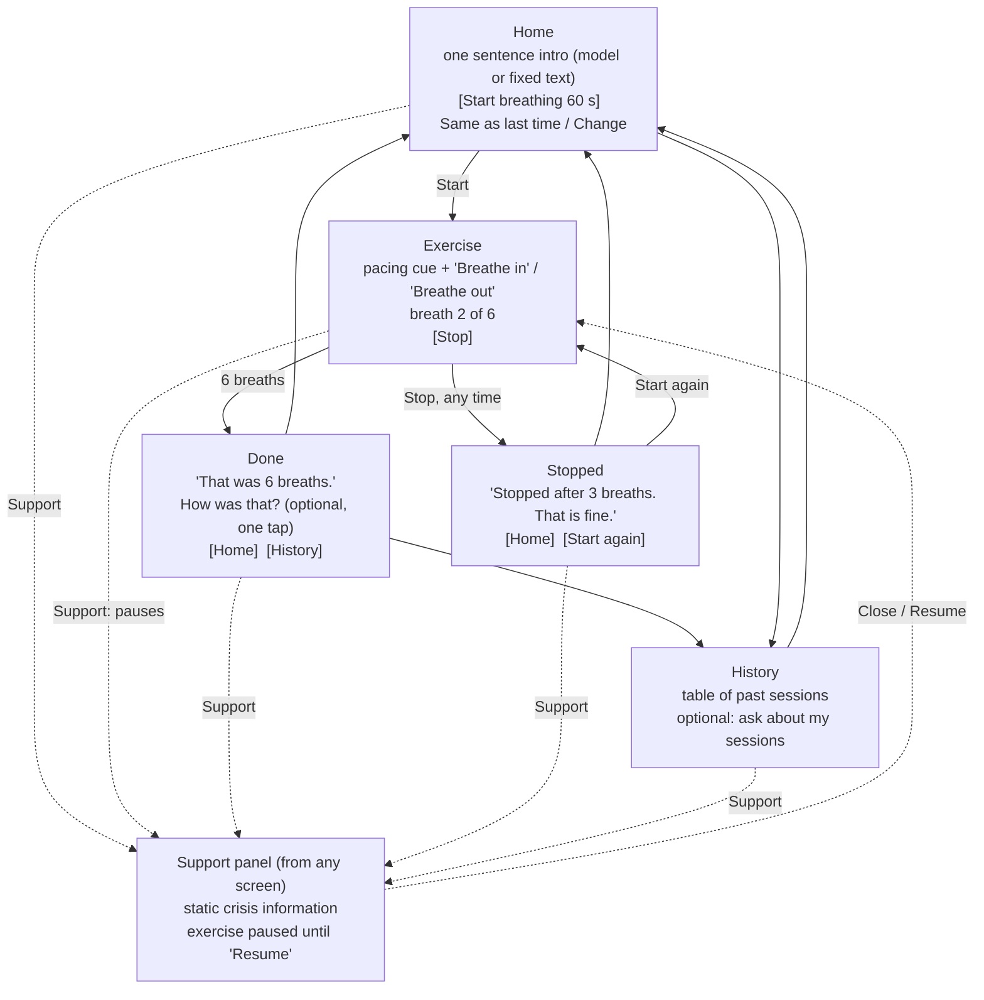

# Design pipeline: Breathe 60

Part 3.1 design, written 2026-10-15. Nothing here is implemented yet. Each decision
names the study finding behind it (R1 to R4, D1 to D6 from the Assignment 3 research
table), the alternative I considered, and what I gave up.

## 1. What the app is

A local coursework prototype for one skill: **paced breathing, 4 seconds in and
6 seconds out**. Someone opens it, presses one button, follows a breathing cue for
60 seconds, and can stop at any moment. Their sessions are saved so the app can offer
"Same as last time" and so they can look back at what they did. A language model
writes a short introduction before the exercise and answers optional questions about
their own saved sessions afterwards. It has no part in the exercise itself.

It is not a support service, does not diagnose, and does not monitor anyone. It is
tested only with fictional scenarios.

**Fictional user.** Alex, a student with a few minutes between classes, on a phone or
a laptop. Alex wants to slow down before the next thing, does not want to read or
type much, and may stop halfway if a friend walks up.

## 2. Why one skill, and why breathing

The study's most-evidenced codes push toward doing one small thing well: D2 (one
atomic skill at a time, 100 mentions), D3 (minimize emotional cost, 148) and R1
(lose people past 90 to 100 seconds, 38). Paced breathing asks for no typing and no
disclosure, and its pace can be carried by the interface itself, so the person does
not have to read while doing it.

| Option | Why not, for now |
| --- | --- |
| Cognitive reframe | Asks the person to name and examine a distressing thought: typing and disclosure, the opposite of D3, and the place where clinical phrasing would most easily read as diagnosis (D6) |
| 5-4-3-2-1 grounding | Fifteen items to identify. Doing it without typing means trusting the person to move on, which is fine, but it competes with breathing for the 90 seconds and doubles the design work |
| STOP | Mostly reading four short steps. Low cost, but there is little for the interface to carry; it would be text on a screen |
| Several skills in a menu | A menu is exactly what D2 participants rejected ("not a library, not a menu, not a dashboard") |

**What I gave up:** R4 asks for choice "by emotional state". With one skill, the
choices are the length and the cue, not which skill. Adding grounding as a second
skill is the first thing I would revisit in Part 3.3 if there is time (open question 1).

## 3. Main flow

The screen sketch is [docs/design/screens.png](design/screens.png) (source:
[screens.html](design/screens.html)). It shows Home, Exercise (animated cue and the
text-only cue), Support over a paused exercise, Done, and History.

Behavior a picture cannot show:

- **Start** is the focused control on Home, so Enter starts the exercise. No sign-in,
  no check-in, no settings first (D3, D5).
- **Stop** is a large button on the exercise screen. One press ends the exercise at
  once: no "Are you sure?", no lost-progress warning, no streak to break (R3). The
  session is saved as `stopped` with the number of breaths done. The Stopped screen
  says so neutrally and offers Home or Start again.
- **Support** is a labelled button in the top bar of every screen, including the
  exercise and every error state (R2, D4). It opens a panel with static content that
  ships with the frontend, so it works with the backend or the model down. Opening it
  during the exercise **pauses** the timer; closing it offers Resume or Stop. Time in
  the panel does not count toward the 90 seconds.
- **Leaving the page** mid-exercise (closing the tab, navigating away) is saved as
  `stopped` when the browser allows a final request; otherwise the session stays
  `in_progress` and is shown as "ended early" in History (open question 4).
- **Reduced motion:** if the operating system asks for reduced motion, or the person
  picks "Text cue", the growing circle is replaced by the words and a count
  ("Breathe in 1 2 3 4", "Breathe out 1 2 3 4 5 6") and a thin progress bar. Same
  timing, no movement.

## 4. Timing budget (R1: no more than 90 seconds)

Measured from the first exercise instruction ("Breathe in", shown when Start is
pressed) to the final planned step ("That was 6 breaths."), including app delays.

| Part of the sequence | 6 breaths (default) | 8 breaths (option) |
| --- | --- | --- |
| Breathe in, 4 s, times N | 24 s | 32 s |
| Breathe out, 6 s, times N | 36 s | 48 s |
| Final line shown | at 60 s | at 80 s |
| App delays during the sequence | about 0 s: the timer runs in the browser and nothing waits on the network | about 0 s |
| **Planned total** | **60 s** | **80 s** |
| Margin to 90 s | 30 s | 10 s |

Assumptions: the person does not have to respond to anything during the sequence, so
there is no response time to assume. Saving the session start is sent without waiting
for the reply, so a slow backend cannot stretch the exercise. Pauses for Support are
excluded, as the assignment says. Nothing forces the person to finish, and nothing
happens to them if they keep breathing after the last line.

**Entry and setup time, reported separately:** from opening Home to pressing Start.
The plan is one tap, about 2 to 5 seconds. The introduction text loads in the
background and never blocks Start. In Part 3.2 I will measure both with the browser
clock and save `entry_ms` and `exercise_ms` with each session.

## 5. Decisions and the findings behind them

| Decision | Finding | Alternative considered | What I gave up |
| --- | --- | --- | --- |
| One skill, one main button per screen | D2 (100), R1 | A skill library or dashboard | Breadth; R4's "choose by emotional state" becomes "choose length and cue" |
| 60 s default, 80 s option, nothing longer | R1 (comfortable around 60 s, lost past 90 to 100) | A 90 s default, or a slider | Some people may want longer; they can start again |
| No typing to do the skill; feedback is one optional tap | D3 (148, the most-evidenced code) | A before-and-after check-in (for example, STAI items) | No measure of change. That fits: a change in a response would not show the exercise caused anything |
| Stop always visible, one press, no confirmation, neutral "Stopped" screen | R3 (39; all 15 raised it on the permission-to-stop task) | Confirm dialog to prevent accidental stops | An accidental tap ends the exercise; Start again is one tap away |
| Support button in the top bar of every screen, static, independent of the model | R2 (30), D4 (31: participants noticed when safety disappeared inside an exercise) | A Support link only on Home, or a model that decides when to show help | Some top-bar space on small screens |
| "Same as last time" offered on Home, with Change next to it | D5 (49: "use my usual skill"), R4 (68) | A settings screen, or silently applying the last choice | A little text on Home; the person sees what was remembered |
| Contraction is in the person's hands: the exercise screen holds only the cue, Stop and Support, and a "Fewer words" setting trims Home | D1 (54), with the study's own caveat that it does not establish how to detect distress | Infer distress from click speed or hesitation | The app never adapts on its own. The Macaulay (2004) reading found no significant correlation between click measures and self-reported anxiety, so I do not treat behavior as a state |
| Muted colors, slow easing, plain verbs, no praise, no clinical words | D6 (97: clinical phrasing felt like diagnosis, cheerful phrasing like condescension, saturated color and motion like demand) | Encouraging copy ("Great job!") or a streak | Less "engagement" by design |
| The model is outside the exercise | R1 timing, R2/D4 safety, D6 tone | The model leads the breathing step by step | The exercise text is fixed, not personalized |

## 6. The model's role and its limits

What the model does:

1. **Introduction (before).** One or two sentences, at most 30 words, shown on Home.
   It may reflect the person's own last choice ("Last time you picked the text cue;
   it is ready again.") using the session and preference records retrieved for this
   demo user. It is written from a reviewed skill description in a prompt file, not
   from the model's own idea of breathing advice.
2. **Questions about my sessions (after).** On the History screen, an optional box:
   "Ask about your saved sessions", for example "How many times did I finish this
   week?". This uses the class SQL retrieval pattern: the model proposes one
   read-only query over this user's records, FastAPI checks it (one SELECT, allowed
   tables only, this user only, row and time limits, read-only connection) and runs
   it, and a second call answers from the returned rows only.

What the application controls, never the model:

- The breathing sequence, its timing, and the words shown during it.
- Stop, pause, resume, and what is saved when someone stops.
- The Support button and its content.
- Which records the model may read (this user's sessions and preferences; never the
  messages table, so earlier text cannot steer later answers).

Limits on the model's output: length cap; no advice beyond the reviewed skill text;
no diagnosis, no claims of improvement, no comment on someone stopping early unless
they ask; plain, non-judgmental wording (D6). If the model fails, times out, or
returns something that breaks a rule the app can check (too long, empty), the app
shows fixed text instead ("Breathe in for 4, out for 6. Six breaths, about a
minute.") and the exercise works exactly the same. A failed request is saved as
failed; no reply is invented.

**Crisis-related input (a deliberate decision).** The only free text the app accepts
is the optional question box. Before any model call, the backend checks the text
against a short list of crisis phrases (for example "kill myself", "end my life",
"suicide", "hurt myself", "self-harm", "overdose"). On a match it does **not** call
the model; it returns a fixed message that points to the Support panel, and the
panel opens. The message is saved with status `blocked`. Limits, stated plainly: a
word list misses indirect phrasing and flags innocent uses ("the suicide squad
film"). That is acceptable only because Support is always one tap away regardless
of this check; the check adds a route, it is never the route. A system prompt alone
is not relied on.

## 7. Support content (planned, to be verified in Part 3.2)

Static text bundled with the frontend. Draft entries, each to be checked against the
official source before Part 3.2 presents them as usable:

- 988 Suicide and Crisis Lifeline (US): call or text 988.
- Crisis Text Line: text HOME to 741741.
- Emergency: 911.
- Penn State Crisis Line (to be confirmed from Penn State CAPS).

The panel also says what this app is: "This is a class project, not a support
service. Nobody is monitoring this app."

## 8. Data I plan to store

All records belong to one fictional demo user, `alex-demo`, marked as a fixture.

| Table | What it holds | Used for | Shown back |
| --- | --- | --- | --- |
| `exercise_sessions` | id, user, `planned_breaths` (6 or 8), `cue` (circle or text), `started_at`, `ended_at`, `status` (in_progress, completed, stopped), `breaths_done`, `entry_ms`, `exercise_ms`, `client_key` (unique, so a retry cannot duplicate) | History; "Same as last time"; measured timing | History table: date and time, length, completed or stopped after N breaths |
| `session_feedback` | session id, `self_report` (a bit calmer, about the same, not sure), `created_at` | Shown back as the person's own words, never scored | History table, a separate column labelled "Your answer" |
| `preferences` | user, key (`length`, `cue`, `fewer_words`), value, `source` (chosen), `updated_at` | Pre-selecting "Same as last time" | Home, next to Change |
| `conversations` | id, user, `purpose` (intro or history question), `started_at` | Grouping messages | History, "Questions you asked" |
| `messages` | id, conversation, `role` (user, assistant, tool), `stage` (question, proposed_sql, executed_sql, retrieval_result, answer, error), content, `status` (ok, failed, blocked), `created_at`, `prompt_version` | Rebuilding each answer and its evidence, as in my Assignment 2 chatbot | History, in order, with time |

Kept apart on purpose: **observed** facts (completed or stopped, breaths done,
timing) and **self-report** (the optional tap) are different columns in different
tables, and the app never turns either into an interpretation such as "you seem
stressed".

Not stored: opening the Support panel (recording it would imply monitoring and adds
nothing the person needs), per-breath timestamps, any inferred mood, any real
personal information.

## 9. Planned endpoints (contracts to confirm in Part 3.2)

| Method and path | Input | Success | Failure |
| --- | --- | --- | --- |
| `GET /api/health` | none | status, record counts, whether a model key is configured (never the key) | 500 if the database cannot open |
| `GET /api/intro` | none | `{text, source: model or fixed}` | never an error page: fixed text with `source: fixed` |
| `POST /api/sessions` | `{planned_breaths, cue, entry_ms, client_key}` | 201 `{session_id}`; 200 with the same id if `client_key` was already used | 422 on bad input; the exercise runs anyway |
| `PATCH /api/sessions/{id}` | `{status: completed or stopped, breaths_done, exercise_ms}` | 200 updated session | 404, 409 if already finished, 422 |
| `POST /api/sessions/{id}/feedback` | `{self_report}` | 201 | 404, 422 |
| `GET /api/sessions` | optional limit | sessions, newest first, with feedback | 500 shown as "History could not load", never as empty |
| `GET`/`PUT /api/preferences` | `{length, cue, fewer_words}` | current preferences | 422 |
| `POST /api/ask` | `{question, conversation_id?}` | answer, the query, the rows, status (`answered`, `no_match`, `insufficient_data`, `rejected`, `blocked`) | 429, 502, 503 with a clear message; Support unaffected |
| `GET /api/conversations/{id}` | none | messages in order | 404 |

## 10. Failure and interruption behavior

| Situation | What the person sees |
| --- | --- |
| Model down or slow | Fixed intro text; Start works. In History, "The question could not be answered right now" and the question is saved as failed |
| Backend down | Exercise still runs (the timer is in the browser); a quiet note that this session was not saved; Support works |
| Stop pressed | Exercise ends at once; saved as stopped with breaths done |
| Support opened mid-exercise | Timer pauses; panel offers Resume or Stop |
| Tab hidden mid-exercise | Timer pauses (the cue cannot be followed while hidden); Resume on return |

## 11. Questions I still need to resolve

1. Is one skill enough for R4's "choose by emotional state"? Adding grounding later
   would give a real choice, at the cost of D2 and the time budget.
2. Should the model's introduction mention the person's history at all, or would
   "Last time you..." feel like being watched (D6, and the rule against implying
   monitoring)? I plan to test both wordings with fictional scenarios.
3. Is 4 in and 6 out right for everyone? Some people find 6 seconds out too long.
   A gentler 3 and 5 option would change the skill as specified, so I have not
   added it.
4. What should happen to a session left `in_progress` because the tab closed?
   Show it as "ended early", or not show it?
5. Phone layout: is the top-bar Support button reachable with one thumb while the
   cue is in the middle of the screen?
6. Which crisis entries to show, and how to keep them accurate; they must be
   checked against official sources before Part 3.2.
7. Does a one-tap "How was that?" add enough value to justify asking anything at
   all after the exercise (D3)? It is skippable, but it is still a question.

## 12. Sources

- Assignment 3 research table: 15 patients, 13 clinicians, 15 evaluation sessions;
  codes R1 to R4 and D1 to D6 with mention counts. These counts show where findings
  appeared in the study, not clinical effectiveness.
- Class ideation page readings (read 2026-10-15): Macaulay (2004) on mouse-click
  speed and STAI anxiety (no significant correlation between the click measure and
  self-reported state anxiety); Austin et al. (2020), a DBT mobile app used alongside
  therapy (participants wanted easier navigation, the ability to hide irrelevant
  functions, and a clear route back to a familiar skill; low energy and forgetting
  limited use).
- My Assignment 2 hotel chatbot, whose read-only SQL retrieval, saved conversation
  trace, and failure states I plan to reuse (`Kelvin-prog-stu/expedia-lite`).

## 13. Part 3.2: what was built, and what changed from the design (2026-10-26)

### Who owns what (MVC)

| Responsibility | File |
| --- | --- |
| Model: tables, allowed values | `backend/models.py` |
| Controller: every application read and write | `backend/database.py` |
| Controller: the model's two jobs, crisis screen, mock and fail modes | `backend/assistant.py` |
| Controller: running model-proposed SQL, read-only and user-scoped | `backend/retrieval.py` |
| The only Gemini caller (reused from my Assignment 2) | `backend/llm_client.py` |
| Thin routes and validation | `backend/main.py` |
| Settings from `backend/.env` | `backend/config.py` |
| View: screens, timer, pacing cue, Support | `frontend/src/App.vue`, `components/BreathingExercise.vue`, `components/SupportPanel.vue`, `components/HistoryView.vue` |
| Static Support content (no request needed) | `frontend/src/support.js` |
| The model's instructions | `prompts/breathing-guide.md` (version hash saved with every message) |

### Endpoints as built

| Method and path | Input | Success | Failure |
| --- | --- | --- | --- |
| `GET /api/health` | none | record counts, model name, "key is configured" or not, prompt version | 500 `storage_error` |
| `GET /api/intro?mode=` | live, mock or fail | `{text, source: model, mock or fixed, conversation_id}` | never fails for a model problem: fixed text, and the failure is saved |
| `POST /api/sessions` | `planned_breaths` 6 or 8, `cue`, `entry_ms`, `client_key` | 201 new row; 200 same row when `client_key` repeats | 422 |
| `PATCH /api/sessions/{id}` | `status` completed or stopped, `breaths_done`, `exercise_ms`, `paused_ms` | 200 | 404, 409 already finished, 422 |
| `POST /api/sessions/{id}/feedback` | `self_report` | 201 | 404, 422 |
| `GET /api/sessions` | `limit` | sessions newest first, with the answer | 500 shown as "History could not load" |
| `GET`, `PUT /api/preferences` | `breaths`, `cue`, `fewer_words` | current choices plus which ones were actually chosen | 422 |
| `POST /api/ask` | `question` (3 to 300 characters), `mode` | status answered, no_match, insufficient_data, rejected, query_failed, blocked or failed; the answer; the query; the rows | 400, 403 if a demo mode is off |
| `GET /api/conversations` | `limit` | conversations with their saved steps in order | 500 |

### Changes from the Part 3.1 design, and why

1. **The introduction does not use the SQL retrieval step.** The app passes the remembered
   choices and the last session's facts to the model directly. Reason: these are always the
   same two facts, so a model-written query would add a call and a failure point for nothing.
   Retrieval is used where it earns its place: open questions about saved sessions.
2. **Scope enforced by views, not by trusting the query.** The design said "this user only".
   The build gives the read-only connection three TEMP views filtered to the demo user and
   lets the authorizer read the base tables only through those views. A query naming
   `exercise_sessions` or `messages` directly is refused. (Checked; see verification.)
3. **Demo modes.** Mock and Fail model modes, switchable in a clearly labelled footer, so
   failure paths can be shown and checked without paid calls. Off unless `ALLOW_DEMO_MODES=1`.
4. **"Same as last time" is learned from Start.** Pressing Start saves the length and cue as
   chosen preferences (D5: adapt from what was done, no settings screen). The Home line only
   says "Same as last time" when something was actually remembered.
5. **Support entries verified and one added.** Checked on 2026-10-26: 988 (call or text,
   988lifeline.org), text HOME to 741741 (crisistextline.org), Penn State Crisis Line
   877-229-6400 (studentaffairs.psu.edu/get-urgent-help), and 911.
6. **A hidden tab pauses the exercise** and shows Resume, because the cue cannot be followed
   while hidden. Escape stops the exercise, except while Support is open.

### Not built yet

The Figma capture round trip; the "Fewer words" setting only hides the introduction and the
notice on Home (it does not yet trim other screens); a session cut short by closing the tab is
saved as stopped with 0 breaths when the browser lets the request out, otherwise it stays
"in progress" and History shows "Ended early"; no speech input or output (optional, not chosen).
